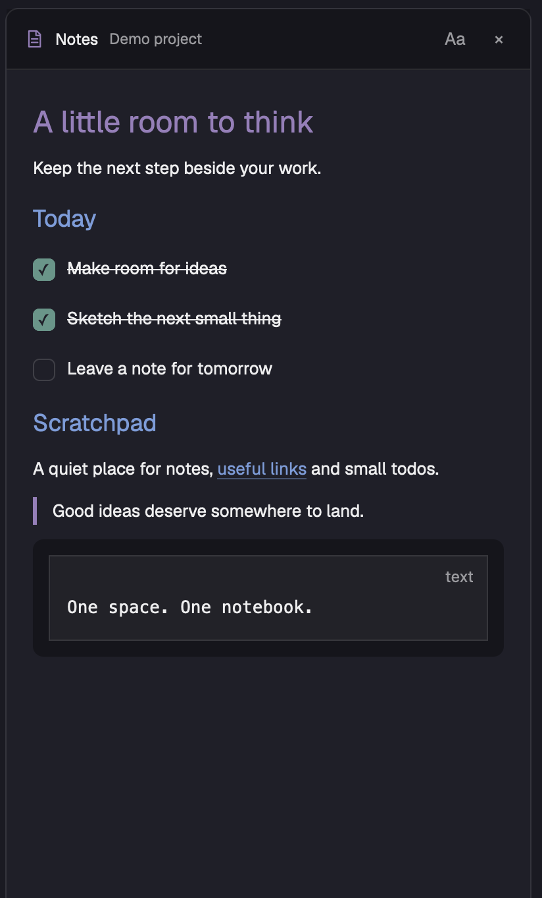

# Herdr Notes

One continuous Markdown note per space, beside Files and Changes. Click anywhere in the page to write; click away to see it formatted automatically. No mode toggle, paragraph boxes or add-block controls.



## Use

Click **Notes** beside Files and Changes to open or close the sidebar. Click the note to edit the whole document. The first edit starts with the cursor at the end so you can add a thought immediately. Later edits reuse the same native text control. Click outside the page, press Escape, or use the platform modifier plus Enter to return to formatted reading. All edits autosave; there is no Save button.

Use **Aa** to set a font family, size (11–24px), and Compact/Comfortable/Spacious line spacing. **Follow Herdr** resets those overrides. By default, Notes uses Herdr's UI font and size. Heading colors, checkboxes, links, quotes and code surfaces follow the current theme.

In the formatted view, task checkboxes update the Markdown directly. Clicking text anywhere else opens the same whole-note editor. Headings and paragraphs are never separate editing targets. This is automatic preview when you leave the editor. Cursor-based live preview, where only the active line shows source, is not implemented: Herdr 0.1.13 exposes neither a cursor-position getter nor a selection-change event to mods. The source editor supports normal text selection, native editing and soft wrapping. Task-list continuation and a formatting toolbar are not implemented.

The small file path is useful: click it to reveal the Markdown file; right-click to copy its full path. Saving status appears only during a file write, and failures stay visible beside Retry.

## Install

Built and checked with Herdr desktop 0.1.13. This is a personal copy of the default layout with two custom mods; the other panels remain Herdr's shipped mods. Read `RECIPE.md` and the source before installing.

Copy `layouts/notes.json` and `layouts/notes.png` into your Herdr home's `layouts/` folder, and `mods/notes/` and `mods/notes-tabs/` into its `mods/` folder. The default home is `~/.config/herdr-app`. Do not replace existing names: rename incoming files/mods and update references if there is a collision. Existing users of this repository can replace their own prior Notes files after backing up their data.

```sh
herdr-app check ~/.config/herdr-app/mods/notes
herdr-app check ~/.config/herdr-app/mods/notes-tabs
herdr-app do layout.switch '{"name":"notes"}'
```

## Storage and recovery

Notes are user data, separate from layout configuration. Each space gets a Markdown file named with its encoded space ID:

- macOS: `~/Library/Application Support/Herdr/notes/`
- Linux: `~/.local/share/herdr/notes/`
- Windows: `~/AppData/Local/Herdr/notes/`

The macOS path is verified in the running app. Linux and Windows have platform branches but have not been runtime-tested. The mod creates the directory with `mkdir` on macOS/Linux or PowerShell on Windows. Revealing a file uses Finder/Explorer, or opens the folder with `xdg-open` on Linux. These are the only external programs Notes invokes. Markdown links use the native renderer; Notes has no cloud service or sync.

On first opening a space, an existing Markdown file takes precedence. Otherwise its previous local-storage pad is copied into a new file. The old pad is retained unchanged. Migration is lazy: opening a space migrates its pad.

Edits get an immediate local recovery draft and a file save after 350ms of inactivity. Writes are serialized and atomic, and require the expected previous file contents. An external edit is not overwritten. On failure, the draft remains in the editor and local storage; Retry repeats the guarded save. Conflicts require manually merging the external file and draft. External edits are picked up when this mod reloads; this version does not watch external editors live.

Fonts and recovery state stay in Herdr-managed local storage. Different space IDs mean different files, even for the same folder. Renaming a space does not change its file path. The host's text-file read limit is 1 MiB.

To return to the default layout, run `herdr-app do layout.switch '{"name":"main"}'`. Layout switching does not delete notes. Back up the notes directory and Herdr's local storage before removing either.

## Validation

```sh
node --test tests/notes.test.mjs
```

Eleven tests exercise the actual Notes class with mocked controls and file storage: migration, restoration, space isolation, safe creation, continuous editing, automatic preview, task changes, failures, draft recovery, conflict protection, overlapping saves and appearance preferences. Native runtime checks and disposable demo screenshots also verify the formatted view, full-note text control and font menu. Physical keyboard input and an app restart are not automated.

The preview uses disposable demo text and is cropped to exclude private workspace content. Neither live notes nor personal settings are in this repository.

## Attribution

`layouts/notes.json` and `mods/notes-tabs/` derive from Herdr 0.1.13's `main` layout and `tabs` mod. Other shipped mods and assets remain dependencies supplied by Herdr. `mods/notes/` is the added Notes panel.
