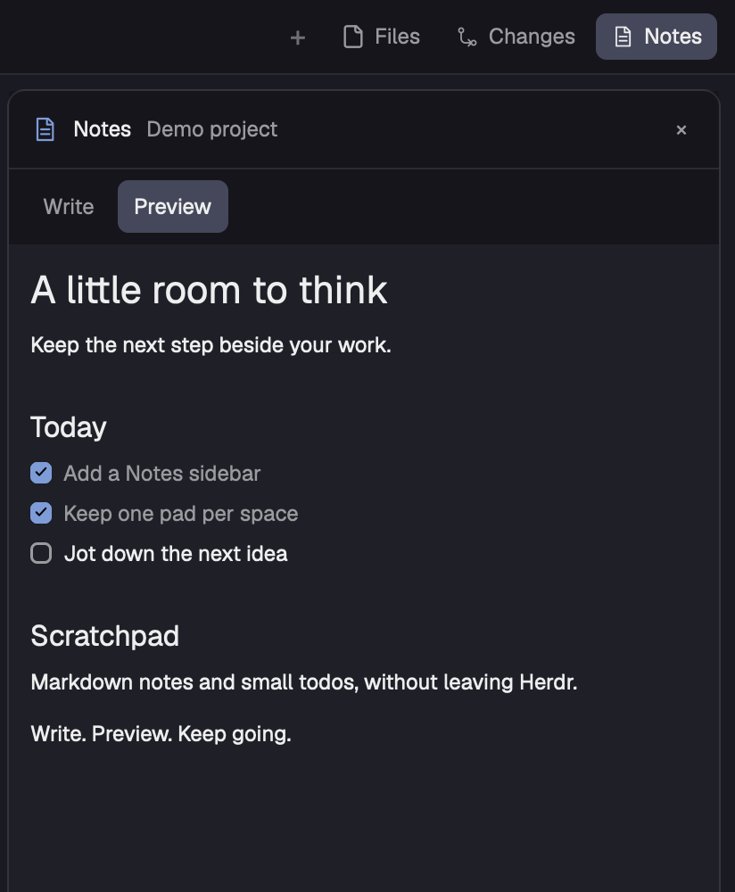

# Notes

Keep one continuous Markdown note beside your terminals in Herdr. Notes opens from the same tab-bar controls as Files and Changes. Click the page to write anywhere in the whole note; leaving it restores formatted Markdown automatically. The interface stays quiet: a small title, the continuous page, and one overflow menu for appearance and file actions. There are no paragraph boxes, add-block buttons or Write/Preview tabs.

## What you see

Use the default Herdr window: a 268px spaces/agents sidebar, the terminal work area, and an optional right panel. Preserve the left sidebar's 46px brand row, equal-weight spaces and agents lists (90px minimum each), and 69px footer. The center has a 42px tab bar, a work area with 8px padding/gaps, and a 28px status bar. Terminal cards have 10px corners, 1px borders/focus outlines and 30px headers.

The right panel starts at 400px and resizes between 280px and 900px. Files, Changes and Notes share it, one shown at a time. Notes is always available; the other two follow existing panel preferences. Start the panel closed unless the tab bar restores a saved choice for that space.

The Notes surface has 10px corners and no extra card border. A 36px header has 24px horizontal padding, a 12px semibold Notes label, a 12px dim truncated space name, transient Saving… text, and one overflow button. No document icon, Aa button, close button, mode toggle, persistent save status, task count or footer. The document fills the remaining height with 28px horizontal padding, 24px top padding and 28px bottom padding.

Use the person's current Herdr theme and fonts rather than hardcoding the mock's graphite/sage palette. In Zen, body and every heading use foreground; links and native controls follow the host theme, checkboxes and quotes use accent, and secondary text uses muted/dim. Heading sizes are body +8px for H1, +4px for H2 and +2px for deeper levels. Task controls are 15px with 4px corners; completed text is struck through. Quotes have a 2px accent line. Use the native code renderer without a second padded card around it. Markdown colors keeps this layout but uses theme ansi5 for H1, ansi4 for H2, ansi6 for deeper headings and checked tasks, ansi5 for quote borders and ansi3 for a 2px code border with 8px left padding. Source editing keeps the same plain native textarea.

The body follows Herdr's normalized font_family/font_size terminal settings, falling back to JetBrains Mono and 14px. Default line spacing is 1.6 times the body size, stated with explicit px units. The overflow menu is a 252px-wide absolute overlay, 34px from the top and 12px from the right, with 6px padding, 8px corners, the popover background and a subtle border/shadow. Its rows are Appearance, Reveal file and Copy path, each with 12px horizontal and 8px vertical padding. The abbreviated path is shown only at the bottom of this menu, with its full path in a tooltip.

Appearance expands inside the menu, with a Preview style choice of Zen (default) or Markdown colors, then Follow Herdr, A−, the current size and A+; a text input for a font family; and Compact, Normal and Roomy choices (1.4, 1.6, 1.85). Font sizes range from 11 to 24px. The preview is a crop of the actual native reading view using a disposable Studio note. Supply it as preview.png and layouts/notes.png. Demo text is not seeded into real pads.

## How it behaves

Click Notes to select/show the panel; clicking it again closes it. Files and Changes retain their behavior. Panel selection/closed state is remembered per space, and the edge resizes by dragging. Tabs inside the same space share a note.

The formatted page is a continuous reading surface. Click anywhere in its body to open one native multiline text control containing the entire Markdown document. Do not edit paragraphs or headings separately, add per-paragraph hover boxes, or insert separators automatically. The first entry puts the cursor at the end for quick note-taking. Reuse that text control on later entries; refresh its value only if a checkbox changed the source while reading. Text selection, normal text editing, soft wrapping and scrolling belong to the native control.

Leaving the page by clicking outside or blurring its input restores formatted Markdown. Escape or the platform modifier plus Enter also finishes editing. Keep the body full height, with no editing card or mode toolbar. Empty notes show only Start writing…. There is no rich-text formatting while typing or automatic bullet continuation.

In reading mode, native checkbox controls toggle task markers directly without opening the editor. Completed task labels are struck through. Regular text clicks edit the whole note; links open through the native URL handler and stop propagation. The Markdown parser may identify source ranges for display and checkbox offsets, but these are not separate editing regions.

Every text change immediately records a local recovery draft and schedules a file save after 350ms of inactivity. File writes are serialized; edits arriving during a write are saved afterward. Show Saving… only while writing, and show failures with Retry. On success, remove the matching recovery draft. No manual save step is required.

Open the overflow menu for Appearance, Reveal file, Copy path, Clear note and Undo clear. Show Clear note only with nonempty text and Undo clear only when a backup exists. Before clearing, store the exact source at cleared:<space-id> and await localStorage.flush(). If that fails or the note changes while awaiting, leave the note intact and show an error. Then clear through the usual change/save path and open the empty editor. Undo restores the backup, appending a blank line and any newly written text, then consumes the backup. Keep the Markdown file. Backups are one level per space and reload with the pad. Appearance expands within it; Reveal file opens the real file location (or the folder on Linux), and Copy path writes the full path to the clipboard. File actions close the menu. Clicking the document closes the menu and starts editing; clicking outside Notes closes it. Appearance preferences persist independently of note text, and Follow Herdr clears the font/size/spacing overrides. Ordinary hover backgrounds apply to controls, never to individual paragraphs.

Preserve inherited tab selection, close, new-tab menu, right-click menu, double-click rename, press/release reordering, wheel navigation and platform window buttons. Working tabs have a native rotating spinner in the working color; blocked/done tabs have their colored dot; idle tabs have no activity marker. Space/agent status and navigation remain shipped behavior. Notes never changes agent status or sends terminal input. Support notes-tabs.toggle-notes via nextCommand(), sharing the same panel toggle as the Notes button. The optional layout:notes key binding alt-shift-n maps to notes-tabs.toggle-notes; keep it limited to this layout.

## Built from

Clone the installed Herdr 0.1.13 main layout into layouts/notes.json, preserving cloned_from metadata. Set preview to layouts/notes.png. The tree is root row → sidebar column and work column; sidebar → brand, sidebar-lists (spaces/agents), sidebar-footer; work → tabs, work-body, status; work-body → main active-tab block and panel column; panel → panel-body stack with files, changes and notes children. Keep panel hidden and panel-body active files by default. Set the panel width to 400px.

Use shipped workspace-chrome, spaces, agents, pane, files, changes, workspace-status, menu and new-menu mods and their assets. Clone tabs into notes-tabs, including its four Windows button SVGs and clone metadata. Rewrite its own SVG paths. Add notes to the enabled panel IDs locally without changing shared workspace.panels. Add the Notes button with the existing panel select/show/hide behavior, preserving the tab bar's saved per-space panel map and platform chrome.

Create mods/notes/main.js, markdown.js, mod.json (place none, title Notes) and an original note.svg (24px outline page, folded corner, two text lines). The main View uses div/svg from gpui-kit and flex, TextareaState/Textarea, TextView, InputState/Input and Checkbox from gpui-base. Read spaces, theme, settings, window and home from herdr; call exec, readTextFile, writeTextFile and watchFolder. Neither custom mod needs props.

Keep a Map of loaded pads per space ID. Each pad holds its path, raw Markdown, last disk snapshot, error/save/loading state and one lazily created native input. Loading a newly selected space starts one asynchronous file read and caches the pad immediately; native text states are created in initialization or a real edit event, never during render. The full-note input updates only its captured pad, even if the active space changes. On close, flush localStorage for recovery.

The display helper parses Markdown headings, paragraphs, quotes, tasks and fenced code while retaining source offsets. Fences close only with the same character and at least the opening length. The checkbox helper changes only its task marker's character; fenced examples remain unchanged. Use native Markdown rendering for body text, task labels and code, and themed native text for headings. These display sections have no individual edit handler or hover state. Source text, including whitespace and final newlines, is never reconstructed from rendered content.

Use actual Markdown files named encodeURIComponent(space.id) + .md. The data directory is home/Library/Application Support/Herdr/notes on macOS, home/.local/share/herdr/notes on Linux and home/AppData/Local/Herdr/notes on Windows. Create it once per mod instance using exec mkdir -p, or PowerShell Directory.CreateDirectory on Windows. Use native readTextFile/writeTextFile for reads and atomic compare-and-write saves. Writes pass the last disk snapshot as expected; null creates a new file. Reveal with open -R on macOS, explorer.exe /select on Windows, or xdg-open on the Linux directory. No shell interpolation of note text, cloud service or network fetch is needed.

Migration is lazy. Existing Markdown takes precedence over legacy localStorage space:<id>; otherwise copy the legacy value into a new file and leave that legacy key unchanged. Recovery drafts use draft:<id> with {text, base}; replay only against the matching base. A mismatched base keeps the draft visible and the original expected snapshot, so Retry cannot overwrite the conflicting external file. Appearance uses a separate local-storage key, including style set to zen or markdown. Do not store notes in the layout/mod folder or include live data in the public package.

## Watch out

Read the installed AGENTS.md and generated type files first. Use native GPUI, not HTML/CSS/DOM or a web view. Shipped files are replaced on restart: keep personal clones. Do not package generated type files, personal settings, local storage or private screenshots. Keep the panel and panel-body layout IDs, and retain Windows controls and macOS traffic-light padding in the cloned tab bar.

An async callback runs immediately until its first await; spawning alone does not leave the render phase. Never create native text state while rendering or notify during render. Never retain a callback's context across an await; use the context given to the spawned task. Use no redraw timer. The 350ms timer is a cancellable save debounce, not an animation or poll.

A bare numeric line_height was visually wrong in this runtime: use a string with px units. Textarea fills the page and owns its scroll; do not wrap it in another scrolling document or size it as a small paragraph editor. Avoid setting its value on every render, which would disrupt selection. A native check only covers eager rendering; also show the full-note editor and menu and appearance controls in the actual app.

Notes are local per-space data, not repository files or cross-device sync. Renaming a space keeps its file; a new ID gets a new file. Watch the notes directory with native watchFolder after creating it, rearming the watch before each refresh. Reload cached pads when files change, skipping pads that are loading or saving. Recheck the disk snapshot and local text after the asynchronous read. When clean, update source, disk snapshot and any retained textarea; ignore unchanged textarea change events. When dirty, keep the draft and old expected snapshot, and show a conflict. Report watcher failures in the panel. Conflicts require manual merging. Local recovery reduces the risk of closing during the debounce but is not a guarantee after forced termination before its storage flush. Reads are limited to the host's 1 MiB text-file limit. Task detection is intended for ordinary bullet checklists and fenced code, not every Markdown dialect. Heading labels are native text rather than a full inline-Markdown editor.

Linux/Windows code paths have not been runtime-tested; macOS is verified. Never publish the raw app frame: crop to demo notes only. Remove temporary demo UI after checking, but retain any demo Markdown the person edited.

## Done when

- Both mods pass herdr-app check, and the actual app shows no new mod/layout errors.
- Notes opens beside Files and Changes and behaves as one continuous page with no mode toggle or paragraph controls.
- Clicking the page produces one full-height native editor containing the exact entire note. Clicking outside or blurring returns to formatted text without changing source or adding separators.
- The same input is reused when re-entering, and an edit from one space still saves to that space after selection changes.
- Clickable task controls update only their source marker; fenced task examples are preserved.
- Fonts follow Herdr by default and appearance preferences persist separately. The menu reveals the real Markdown file and copies its full path.
- Clear note is reversible after reloading; backup failure or edits during backup leave the note intact. Undo keeps new text added since clearing. Both preview styles persist and leave the source unchanged.
- Existing local-storage notes migrate without deleting the old key; existing files take precedence; recoverable drafts restore only against their matching base.
- External edits appear in clean preview/editor states without a writeback. Local edits made before or during a refresh survive, and cached spaces update independently.
- File-save failures preserve the draft, and a conflicting external edit is not overwritten, including by Retry. Overlapping saves finish with the newest text.
- node --test tests/notes.test.mjs passes. The tests mock native controls and file APIs; do not claim physical keyboard or process-restart testing.
- The public package includes the layout, both custom mods, this recipe, safe preview assets and the herdr-layout topic. Switching to main restores the default layout without ending terminals.
